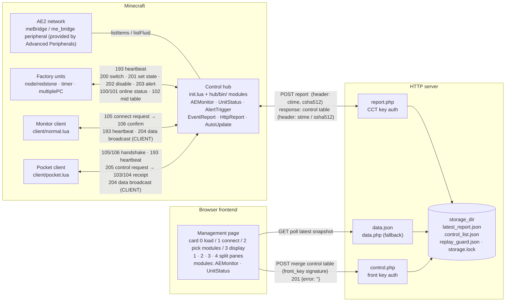

# CCT Factory Hub
中文版: [README_ZH.md](README_ZH.md)

**If the Chinese and English versions differ in meaning, the Chinese version takes precedence.**

CCT Factory Hub is a factory automation toolkit combining "in-game monitoring + remote web management".

* **Control hub (hub)** aggregates the status of every factory unit and the AE2 storage data (requires the Advanced Peripherals mod), and renders them on an in-game monitor;
* **HTTP report module** periodically reports the aggregated data to the PHP server with a signature, and fetches back control commands issued by the browser;
* **Web frontend** lets you inspect that data at any time, and remotely switch units on/off when you hold the control key;
* **Clients** let you check on-site status from a monitor or a pocket computer without leaving the game.

| Capability            | Runtime*      | Description                                                               |
| --------------------- | ------------- | ------------------------------------------------------------------------- |
| Unit status monitor   | hub, front    | Five states: running / standby / stopped / disabled / unknown, paged on a monitor |
| AE2 storage monitor   | hub, front    | Only collects the items and fluids you configure, with trend arrows        |
| Threshold alerts      | hub           | Fires when below/above a threshold; can send an alert or switch the unit   |
| Remote control        | front, client | One tap in the browser or on the pocket computer switches a unit, with two-way receipts |
| Auto reconnect        | (all)         | Units, clients and the hub all reconnect and re-handshake automatically     |
| Platform independent  | server        | The server only needs one `storage_dir`; everything else is generated by `publish.sh` |
| Build-free frontend   | front         | Native ESM, loaded directly by the browser, no Node build step             |

\* See the details below for specifics.

---

## 1. System Architecture

### 1.1 Overview
| Role                | Host                        | Responsibility                                            |
| ------------------- | --------------------------- | --------------------------------------------------------- |
| **hub** (control)   | Main CC:T computer          | Loads modules, aggregates data, commands units, reports and dispatches |
| **node** (factory unit) | Each unit's own CC:T computer | Receives commands, drives redstone output, reports its state |
| **client**          | Monitor terminal / pocket computer | Read-only viewing; the pocket computer can tap to switch |
| **server**          | Any PHP 8 host              | Stores the latest report, buffers the control table, verifies signatures |
| **front**           | Static HTTP directory       | Displays data, sends control, splits panes across modules |

### 1.2 Full Structure Diagram


### 1.3 Directory Layout
```
CCT-Factory-Hub/
├── hub/                        Control hub (copy onto a CC computer)
│   ├── init.lua                Main program: module loading / event loop / debug mask
│   ├── startup.lua.example     Entry template (copy to startup.lua and edit)
│   ├── bin/                    Feature modules (auto-loaded by filename, alphabetical)
│   │   ├── AEMonitor.lua       AE2 storage monitor module
│   │   ├── UnitStatus.lua      Unit status monitor and control module
│   │   ├── AlertTrigger.lua    Threshold alert module
│   │   ├── EventReport.lua     Client connection and session management module
│   │   ├── HttpReport.lua      HTTP external communication module
│   │   └── AutoUpdate.lua      Config auto-update module  (reads new configs from a floppy disk)
│   ├── etc/                    Module configs (same-name .json)
│   │   └── *.json.example      
│   ├── log/                    Runtime logs
│   │   ├── hub.log             Current log
│   │   └── hub.log.1 …         Archived logs (2 kept by default)
│   └── lib/
│       ├── MiniNet.lua         Wireless network protocol wrapper
│       ├── log.lua             Leveled logger class
│       ├── loadJson.lua        JSON reading
│       ├── formatAmount.lua    Number formatting
│       ├── TaskQueue.lua       Async task / timeout queue
│       └── sha2.lua            Third-party SHA-2 implementation (https://github.com/Egor-Skriptunoff/pure_lua_SHA)
├── node/                       Factory units (run on each unit's computer)
│   ├── redstone.lua            Redstone output type
│   ├── timer.lua               Timed-job type
│   └── multiplePC.lua          Child-computer cluster type
├── client/                     Clients (run on a monitor terminal / pocket computer)
│   ├── normal.lua              Monitor edition (paging + touch to flip pages)
│   └── pocket.lua              Pocket computer edition (tap the in-row button to switch)
├── server/                     PHP server
│   ├── bootstrap.php           Signature check / replay guard / atomic write / file lock
│   ├── report.php              CCT report endpoint
│   ├── control.php             Frontend control endpoint
│   ├── data.php                Frontend read fallback endpoint
│   ├── config.example.php      Config template
│   └── publish.sh              One-shot deploy script
└── front/                      Web frontend (statically hosted)
    ├── index.html              Single-page skeleton
    ├── index.js                Connect / card switching / polling / module loading
    ├── index.css               Layout (including dark mode)
    ├── config.js               Central config (poll interval, timeouts, ...)
    ├── lib/                    sendControl / showNote / format
    └── module/                 Feature modules
        ├── activated.json      Module registry
        ├── common.css
        ├── AEMonitor/
        └── UnitStatus/
```

---

## 2. Quick Start

### 2.1 Prerequisites

* **Minecraft + CC:Tweaked**: CC:T 1.100 or newer is recommended;
* Every computer that takes part in communication needs a **wireless modem**;
* The hub needs a **monitor** (an advanced monitor is better; configured per module);
* AE2 monitoring requires the `meBridge` provided by **Advanced Peripherals** (since 1.21.1 the peripheral is named `me_bridge`; both are supported);
* The server needs **PHP 8** (no extension dependencies) and a web server that can host static files;
* The browser must support ES Modules and `crypto.subtle` (all modern browsers do; **on a non-HTTPS LAN IP `crypto.subtle` may be unavailable**, so use HTTPS or localhost).

### 2.2 Server

```bash
# Option 1: only specify the deployment location, defaults for everything else
bash server/publish.sh -d /path/to/webroot/cct-hub

# Option 2: with an explicit configuration
bash server/publish.sh \
  -d /var/www/cct \
  -S /var/lib/cct-hub \
  -c "$(openssl rand -hex 32)" \
  -f "$(openssl rand -hex 32)"
```

| Option | Description                    | Default                                                                                                     |
| ------ | ------------------------------ | ----------------------------------------------------------------------------------------------------------- |
| `-d`   | Deployment target directory (required) | —                                                                                                    |
| `-S`   | Data storage directory         | `/dev/shm/CCT-Factory-Hub`; falls back to `<deploy dir>/.storage` when not writable<br>(if set manually, make sure the PHP process can read/write it) |
| `-c`   | CCT key (64 hex chars)         | Randomly generated                                                                                          |
| `-f`   | Frontend control key (64 hex chars) | Randomly generated                                                                                     |
| `-h`   | Help                           | —                                                                                                           |

Deploy result: `report.php`, `control.php`, `data.php`, `bootstrap.php` and `config.php` (mode 600) appear in the target directory, and a symlink `data.json → <storage dir>/latest_report.json` is attempted (failure only warns; the frontend falls back to `data.php` automatically).

**Two values you must handle**:
1. CCT key: fill it into the hub's `HttpReport.json`;
2. Frontend key: used to authorize frontend control.

Server endpoint overview:

| Endpoint      | Method | Auth       | Purpose                                     |
| ------------- | ------ | ---------- | ------------------------------------------- |
| `report.php`  | POST   | CCT key    | Report data + take the control table away   |
| `control.php` | POST   | Front key  | Write the control table / heartbeat probe   |
| `data.php`    | GET    | none       | Read the latest data (CORS enabled)         |
| `data.json`   | GET    | none       | Same, served as a static file (faster)      |

### 2.3 Control Hub

Option 1: manually copy the contents of `hub/` into the CC:T computer's local storage folder, then copy the templates and edit them;

Option 2: run `wget run https://server2.ycl.cool/CC:T/CCT-Factory-System/install_hub.lua` on the target computer to deploy automatically, then copy the templates and edit them.

Notes:
1. **Peripherals**: wireless modem (required), monitor (via each module's `monitor.name`), `meBridge` (required by AEMonitor).
2. **Channel**: the template uses the computer ID as the wireless channel by default. To let units and clients connect, specify it explicitly: `init:new({ netChannel = 4096 }):doMainLoop()`;
3. **Layout**: `require("init")` relies on `package.path`, and the program derives `/bin`, `/etc`, `/lib` and `/log` from the directory of the entry script.

`Hub:new()` options:

| Option          | Type    | Default            | Description                                                                 |
| --------------- | ------- | ------------------ | --------------------------------------------------------------------------- |
| `netChannel`    | number  | Computer ID        | Wireless channel (0-65535), must match on all units/clients                 |
| `netName`       | string  | First wireless modem | Which modem to use                                                        |
| `timerInterval` | number  | `5`                | Poll interval in seconds (`<2` refuses to start; `<4` or `>600` warns)      |
| `debugMode`     | number  | `0`                | Debug mask (see §5.3); only active when 0x0001/0x0002 is set                |
| `noLog`         | boolean | `false`            | Silence logs (also suppresses creating the log file)                        |
| `noTimer`       | boolean | `false`            | Disable polling (auto-enabled when no module registers a poll)              |
| `noTerminate`   | boolean | `false`            | Ignore the `terminate` event                                                |
| `noReboot`      | boolean | `false`            | Prevent computer reboots                                                    |
| `disabledUnits` | table   | `{}`               | Module names to skip, e.g. `{ "AutoUpdate" }`                               |
| `logFileSize`   | number  | `102400`           | Max bytes per log file; `-1` unlimited, `0` or an invalid value falls back  |
| `logFileCount`  | number  | `3`                | Total log files (including `hub.log`); `0` disables file output, `-1` unlimited archives |

The entries under `disabledUnits` in the repository's `hub/startup.lua.example` are commented out by default; uncomment one to disable that module. For production runs, change `dbgMode` to `0`
 (or use `noLog = true` to silence logs).

When logging is enabled, the hub writes logs to `log/hub.log` under the program directory (created automatically if missing). On every start it first appends a `------ [yyyy-mm-dd hh:mm:ss] ------` separator line, and once a file exceeds `logFileSize` it rolls over to `hub.log.1`, `hub.log.2`, ...;

`logFileCount` is the total number of files **including `hub.log`**; the default `3` means `hub.log` + 2 archives, `0` disables file output (screen logs remain), `-1` leaves the number of archives unbounded. `noLog = true` silences all logs and no log file is created (in debug mode logging is still enabled and written).


**Module config**: copy the templates and fill them in; the filename must match the module name in `bin/`:

| File                 | Key fields                                                                                          |
| -------------------- | --------------------------------------------------------------------------------------------------- |
| `AEMonitor.json`     | `monitor{name,minWidth,minHeight}`, `list[]` (`id`/`name`/`type=item\|fluid`/`unit`), `queueEvent`  |
| `UnitStatus.json`    | `monitor{...}`, `list[]` (`name`/`tag`; `tag` must match the unit's `user.lua`)                     |
| `AlertTrigger.json`* | **Top-level array**; each entry has `objectId`/`objectType`/`cellType`/`cellTag`/`thresholds[]`     |
| `HttpReport.json`    | `key` (CCT key), `url` (`report.php` address), `relaySide`, `relayName` (optional), `timeTolerance` |

\* `AlertTrigger`'s `cellType` decides which signal is sent: `0` alert (203), `1` set state (201), `2` set disabled (202); `thresholds[].type` is `less` / `more`, and `alertType` is `0` send on every crossing, `1` alert once and silently re-arm on recovery, `2` send on both alert and recovery.

### 2.4 Factory Units (node)

Option 1: put the script you need together with **your own `user.lua`** on the unit computer, and set that script as the startup program;

Option 2: on the target computer, use `wget` to download from the path prefix `https://server2.ycl.cool/CC:T/CCT-Factory-System/node/` (the file layout on the site matches the repo's `node/` folder), then put **your own `user.lua`** on the unit computer.

> Unit scripts load their config via `require("user")`. If startup prints `User script load error: module 'user' not found`, make sure both files are in the same directory.

`user.lua` exports different contents per unit type (all three types require `staticCfg`):
```lua
local M = {}

M.staticCfg = {
    tag        = "carpet_production", -- must match the tag in hub/etc/UnitStatus.json
    serverId   = 4096,                -- the hub's wireless channel (not the computer ID)
    input      = 2,                   -- optional: hard-disable input side (1 bottom … 6 left)
    output     = 3,                   -- redstone type: redstone output side
    waitTime   = 10,                  -- timer type: interval per run (minutes)
    childInId  = 1,                   -- multiplePC type: uplink channel ID to child computers on the wired network
    childOutId = 2                    -- multiplePC type: downlink channel ID to child computers on the wired network
}

-- Required by redstone / timer types; not used by multiplePC
function M.doControl(runData, side, hardDisabled)
    -- runData.status: whether it is running; runData.disabled: whether it is soft-disabled
    redstone.setOutput(side, runData.status)
end

-- Optional: restore state after a reboot
function M.doRecovery(runData, side) end
-- Optional: callback when a 203 alert arrives
function M.doTrigger(runData, tag, status) end
-- Optional: extra event hooks, e.g. M.eventMap = { modem_message = fn }
M.eventMap = {}

return M
```

| Unit type        | `staticCfg`                                                | Required function                        | Typical use              |
| ---------------- | ---------------------------------------------------------- | ---------------------------------------- | ------------------------ |
| `redstone.lua`   | `tag`, `serverId`, `output`, optional `input`              | `doControl(runData, side, hardDisabled)` | Start/stop a single redstone machine |
| `timer.lua`      | `tag`, `serverId`, `waitTime`, optional `input`            | `doControl(runData, hardDisabled)`       | Periodic jobs            |
| `multiplePC.lua` | `tag`, `serverId`, `childInId`, `childOutId`, optional `input` | **none** (control is delegated to the child) | Managed child-computer cluster |

`runData` has three fields: `status` (running), `disabled` (soft-disabled), `serverOnline` (whether the session with the hub is online).

### 2.5 Clients

Option 1: copy the script you need into the unit computer's storage directory;
Option 2: on the target computer, use `wget` to download from the path prefix `https://server2.ycl.cool/CC:T/CCT-Factory-System/client/` (the file layout on the site matches the repo's `client/` folder).

Set the channel on the terminal / pocket computer and run:
```sh
set factoryhub.serverId 4096            # must match the hub's netChannel
set factoryhub.monitorName monitor_1    # required by normal.lua, selects the output monitor

normal.lua/pocket.lua                   # run the matching file
```

* `client/normal.lua`: pages statuses on a monitor, touch `Last / Next` at the bottom to flip pages, reconnects automatically on disconnect;
* `client/pocket.lua`: displays on a pocket computer; tapping the in-row button requests a switch immediately, and the button stays locked until a receipt arrives or it times out.

### 2.6 Web Frontend

> ⚠️ **External dependency**: `front/index.js` imports three helpers — `getUrlParams` / `isMobile` / `loadExternalResource` — from `https://tool.ycl.cool/public-library/function.esm.min.js`. For offline or intranet deployments, download that library locally and rewrite the import path at the top of `index.js`, otherwise the panel will not start. The source of that module can be found at [https://github.com/YCL0609/YCL-Public-library](https://github.com/YCL0609/YCL-Public-library).

Once the page is open, fill in:

| Field       | Description                                                                                 |
| ----------- | ------------------------------------------------------------------------------------------- |
| Server URL  | Full URL of the directory containing `report.php` / `control.php`, without a trailing `/`    |
| Control key | The `front_key` in `config.php`; **leave empty to run read-only**, view only, no control    |

URL parameters (combinable):

| Parameter | Description                                        | Example                                  |
| --------- | -------------------------------------------------- | ---------------------------------------- |
| `server`  | Prefill the server URL (needs `encodeURIComponent`) | `server=http%3A%2F%2F192.168.1.10%2Fcct` |
| `select`  | Preselect modules, comma-separated                 | `select=AEMonitor,UnitStatus`            |
| `mode`    | Split-pane mode 1-4                                | `mode=2`                                 |
| `auto`    | When truthy, auto-connect and jump to the display  | `auto=1`                                 |

Display modes: `1` single module, `2` left/right two panes, `3` one left two right, `4` four-pane grid; the number of selected modules must match the mode. The poll interval defaults to 15s and pauses automatically when the page goes to the background.

The AEMonitor frontend module needs a `module/AEMonitor/list.json`:
```json
{
  "items":   ["minecraft:coal", "minecraft:quartz"],
  "fluids":  ["mekanism:hydrogen"],
  "reverses": ["minecraft:coal"]
}
```
The `reverses` field inverts the trend arrow of an entry.

---

## 3. Communication Protocol (CC Intranet)

All CC devices share **the same wireless channel** (the hub's `netChannel`; `serverId` on units and clients) and address each other logically via the `tag` inside the message body.

The receiver checks that the 4th item (replyChannel) of the `modem_message` event equals `serverId`; the 5th item is then the message body:
```lua
{
    tag  = "carpet_production", -- target: unit tag; "ALL" everyone; "CLIENT" clients
    code = 200,                 -- message code (see the table below)
    mid  = "a1b2c3",            -- message ID: pairs a request with its 103/104 receipt
    data = { },                 -- attached data, optional
}
```

**Message codes**:

| Code  | Direction           | Meaning                                                                |
| ----- | ------------------- | ---------------------------------------------------------------------- |
| `100` | hub → everyone      | Host online (units/clients re-handshake accordingly)                   |
| `101` | hub → everyone      | Host offline                                                           |
| `102` | hub → everyone      | Sync the mid table (`data = { tag = mid }`)                            |
| `103` | anyone → requester  | ACK (paired by `mid`, may carry `data`)                                |
| `104` | anyone → requester  | NCK rejected (paired by `mid`)                                         |
| `105` | client → hub        | Client connect request (`data.clientId`)                               |
| `106` | hub → client        | Connect confirm (`tag = "CLIENT"`, `data.clientId`)                    |
| `107` | client → hub        | Client disconnect                                                      |
| `193` | unit/client → hub   | Heartbeat (`data.status` may carry the state)                          |
| `194` | hub → unit/client   | Heartbeat reply failure (NCK Ping)                                     |
| `200` | hub → unit          | Toggle unit state (`tag` required, `"ALL"` allowed)                    |
| `201` | hub → unit          | Set unit state (`data.status` boolean, `ALL` forbidden, stopped/running units only) |
| `202` | hub → unit          | Toggle disabled state (`ALL` allowed, may be overridden by physical signals) |
| `203` | hub → unit          | Trigger alert (`data.tag`, `data.status`)                              |
| `204` | hub → client        | Runtime data push (`tag = "CLIENT"`, `data.type` event name, `data.data` content) |
| `205` | client → hub        | Request a unit switch (`tag` required, `ALL` forbidden, `payload.mid` is the client id) |

The `MiniNet` library (`hub/lib/MiniNet.lua`) wraps these details:

| Method                                                       | Description                                                                                                                        |
| ------------------------------------------------------------ | ---------------------------------------------------------------------------------------------------------------------------------- |
| `net:send(tag, code, data, retryLimit, callback)`            | Sends and waits for `103/104`, returns `mid`; `retryLimit` is the **allowed number of timeouts** (passing `2` gives up after one timeout); `callback` fires on receipt or timeout |
| `net:broadcast(tag, code, data, mid)`                        | Broadcast directly                                                                                                                 |
| `net:startTasks({mid, rawCount, callback})` / `stopTask(id)` | Register a persistent task (e.g. a client session)                                                                                 |
| `net:setMessageListener(code, fn)`                           | Take over a message code (`<200` is routed to the shared callback 0; one listener per code)                                        |
| `net:poll()` / `net:epoll(event)`                            | Driven by the main loop                                                                                                            |
| `net:open(ids)` / `net:close()`                              | Open / close the channel                                                                                                           |

Callback signature: `(taskId, code, isTimeout, returnedData) -> boolean`; return `true` to keep listening.

---

## 4. HTTP Protocol

### 4.1 Signing

Every write operation must be signed (the CCT side uses `cct_key`, the frontend uses `front_key`; both are 64-character hex strings):

```
body    = the raw JSON string of the request body (identical character by character, no re-serialisation)
ctime   = millisecond timestamp string
csha512 = HMAC-SHA512(key, body .. ctime)   -- lowercase hex
```

Request headers: `ctime: <ctime>`, `csha512: <csha512>`, `Content-Type: application/json`.

The server only processes the request when the timestamp is within `time_tolerance_ms` (default 30000ms), and registers `(ctime, csha512)` in `replay_guard.json`: **a given signature pair can be used only once** (repeat → `409`); if registration fails the request is rejected (fail-closed).

Responses carry signature headers too: `stime`, `ssha512 = HMAC-SHA512(cct_key, body .. stime)`, which the CCT side uses to verify the response was not tampered with.

### 4.2 Reporting `POST report.php` (CCT key)

The request body is free-form JSON and is wrapped into the snapshot as-is:

```json
{
  "unit_status_change": [
    { "tag": "carpet_production", "name": "Carpet production", "status": 4, "inProcess": false }
  ],
  "ae2_cache_update": {
      "items":  {
        "minecraft:coal": { "name": "minecraft:coal", "amount": 12345 }
    },
    "fluids": {
        "mekanism:hydrogen": { "name": "mekanism:hydrogen", "amount": 4500 }
    }
  }
}
```

Server snapshot structure (`latest_report.json` / `data.json`):
```json
{ "report_time": "1750000000000", "data": { } }
```

\* The `data` field holds the report body.

The response body is the **control table** (taken and cleared on read):

```json
{ "carpet_production": true }
```

| Status | Meaning                                           |
| ------ | ------------------------------------------------- |
| `200`  | Success; the body is the control table (`{}` when empty) |
| `400`  | Missing signature headers / invalid JSON          |
| `401`  | Bad signature                                     |
| `403`  | Timestamp outside the tolerance                   |
| `409`  | Replay (same ctime + same signature already used) |
| `500`  | Storage not writable                              |

### 4.3 Control `POST control.php` (front key)

The request body must be an **object** (arrays are rejected):

```json
{ "carpet_production": true }
```

Merge semantics (the server does read-modify-write on the existing control table while holding the file lock):

| Form                                   | Effect                        |
| -------------------------------------- | ----------------------------- |
| `{ "tag": true }` / `{ "tag": false }` | Set to the given value        |
| `{ "tag": null }`                      | Remove that entry             |
| `{ "__reset": true }`                  | Clear the whole control table |
| Any other key starting with `__`       | Ignored (reserved by the server) |

| Status                | Meaning                                   |
| --------------------- | ----------------------------------------- |
| `201`                 | Written successfully (`{"error":""}`)     |
| `204`                 | Heartbeat probe (`{"ping":true}`), writes nothing |
| `400`                 | Request body is not an object             |
| `401` / `403` / `409` | Same as the report endpoint               |
| `500`                 | Storage not writable                      |

### 4.4 Reading `GET data.php` / `data.json`

Returns the snapshot structure (`report_time` + `data`) with CORS headers. Before the first report it returns `404 {"error":"No report data available yet"}`. The frontend tries the static `data.json` first (fast) and falls back to `data.php`.

---

## 5. Extending

### 5.1 Hub Modules

Create `MyModule.lua` in `hub/bin/`; it is auto-loaded at startup (ordered by filename), and its config is read from `hub/etc/MyModule.json` (an empty table if missing). Minimal skeleton:

```lua
local MyModule = {}
MyModule.__index = MyModule

--- @param config table      contents of etc/MyModule.json
--- @param libs table        { log = Log, net = MiniNet, root = <hub root dir> }
--- @param debugMode number  debug mask
function MyModule:new(config, libs, debugMode)
    local obj = setmetatable({}, self)
    obj._config, obj._libs = config, libs
    return obj
end

--- Declare the events you need: poll timer, monitor, monitorName; other = custom events
function MyModule:getEventList()
    return { poll = true, monitor = false, other = { "my_custom_event" } }
end

--- Called once every timerInterval seconds
function MyModule:poll() end

--- Receives raw CC events (including custom events, modem_message, monitor_touch…)
function MyModule:epoll(event) end

return MyModule
```

Requirements:

* Custom events must be **registered in `getEventList().other`**; otherwise `os.queueEvent("my_custom_event", ...)` is dropped by the main loop;
* Reserved events (`terminate`/`reboot`/`poll`/`newTask`/`modem_message`/`monitor_touch`) cannot be registered;
* Log through `libs.log` (`debug/info/warn/error/fatal/fatalNoExit`);
* Exceptions thrown by a module are isolated by `pcall` and do not take the whole computer down; a failed `new` only skips that module.

Two ways to push data to the frontend:
1. **Reuse `EventReport`**: it currently forwards only the `ae2_cache_update` and `unit_status_change` events (governed by `noAE2Update` / `noUnitChange` in `EventReport.json`). To add an event type you must append its key inside that module's `_enabledMap` — that means editing a core module, so do it carefully.
2. **Push yourself**: call `libs.net:broadcast("CLIENT", 204, { type = "my_data", data = payload })` directly, and the frontend module reads it from `data.my_data` inside `dataUpdate`. The event must first be delivered to your module (`os.queueEvent("my_data", payload)` + registering it in `getEventList().other`); caching and replay after reconnect are your responsibility.

### 5.2 Frontend Modules

Create a directory under `front/module/`, implement three methods, and register it in `front/module/activated.json`:

```js
// front/module/MyModule/index.js
export default class MyModule {
    async init(ctx) {}                    // load config, build DOM (may fetch your own static JSON)
    dataUpdate(data, ctx) {}              // data is the data field of the report body
    divUpdate(node, isFirst, ctx) {}      // node is one pane container; isFirst indicates the first frame
}
```

```jsonc
// front/module/activated.json
[{ "name": "MyModule", "desc": "One-line description", "css": true }]
```

`ctx` provides:

| Field                                   | Description                                    |
| --------------------------------------- | ---------------------------------------------- |
| `ctx.sendData(payload)`                 | Send control (auto-ignored with a note in read-only mode) |
| `ctx.showNote(level, text, noTimeout?)` | Top-right note; `level` is `info`/`warn`/`error` |
| `ctx.config`                            | The `modules.<name>` object from `config.js`   |
| `ctx.getReportTime()`                   | Time of the latest report                      |

Conventions: `dataUpdate` only handles data, `divUpdate` only renders; both are guarded by `render_timeout` (5s); when `css: true` the host auto-loads the sibling `index.css`.

### 5.3 Debug Mask

Pass an integer to `Hub:new({ debugMode = ... })` and combine bits (debug is only on when 0x0001 or 0x0002 is set):

| Bit | Value    | Effect                                             |
| --- | -------- | -------------------------------------------------- |
| 0   | `0x0001` | Enable debug mode (log level DEBUG)                |
| 1   | `0x0002` | Also start a debug shell and expose the hub object as `_G.HubObj` |
| 2   | `0x0004` | Force-disable all event handling                   |
| 3   | `0x0008` | Disable screen touches                             |
| 4   | `0x0010` | Disable network events (`modem_message`)           |
| 5   | `0x0020` | Disable custom events                              |
| 6   | `0x0040` | Disable reboot logic                               |
| 7   | `0x0080` | Reserved for module use                            |
| 8   | `0x0100` | Expose the event queue globally                    |
| 9   | `0x0200` | Hang instead of exiting on a normal terminate      |
| 10  | `0x0400` | Do not clear the screen on exit                    |
| 11  | `0x0800` | Do not close the network on exit                   |

---

## 6. Security Notes

* **Authentication lives on the server**: `control.php` verifies the signature with `front_key`; any failure is 401/403 regardless of whether the frontend "shows" the button;
* **Read-only mode**: when no key is entered, `serverCtrl.readonly` is true; clicking a control button only shows "No control key provided, control signal ignored", and the server never receives a valid signature either;
* **Where the key goes**: the key stays only in your browser memory (the `input` element) and in local JS variables; it **never enters the URL, request body, localStorage or logs**; signatures are computed locally with `crypto.subtle`;
* **Replay protection**: a `(ctime, signature)` pair can be used only once inside the time window; repeats return 409;
* **The viewing side is public**: `data.php` / `data.json` are unauthenticated, so anyone who can reach the URL can see the factory data. Keep it on an intranet, or add access control at a front proxy;
* **Shared key, no audit**: `front_key` is a single shared key; the actions of all key holders are indistinguishable, and there is no per-user operation log (use the outermost reverse proxy if you need an audit trail);
* **The CC intranet is plaintext**: messages on the wireless channel are not encrypted; any computer on the same channel can read them, so never send sensitive information over it.

---

## 7. Troubleshooting

| Symptom                                    | What to check                                                                       |
| ------------------------------------------ | ----------------------------------------------------------------------------------- |
| Computer reports `modem peripheral not found` | No wireless modem / not attached, or `netName` points at a wired adapter         |
| Hub log shows `Module 'X' failed to load`  | Bad `require` path inside `hub/bin/X.lua`, or a missing dependency under `hub/lib/`  |
| Hub log shows `Module 'X' failed to initialize` | A missing or wrongly-typed field in `hub/etc/X.json`; check the reported line   |
| The monitor is completely blank            | No monitor name configured for the module, or the resolution is below `minWidth`/`minHeight` |
| AEMonitor reports `meBridge terminal not found` | Advanced Peripherals is not installed, or the bridge is not on the same network |
| A unit stays `Unknown`                     | The unit's `tag` does not match `UnitStatus.json`, or the unit is not on the same channel |
| A unit reports `User script load error`    | `user.lua` is not on `require`'s search path; see the note in §2.4                  |
| Frontend says "server reports no data"     | The hub has not reported successfully yet; check the hub's HttpReport log first      |
| An endpoint returns 401                    | Signature mismatch: browser → is `front_key` the same as in `config.php`; hub → is `cct_key` the same |
| An endpoint returns 403                    | Timestamp outside the tolerance (`time_tolerance_ms`); sync the clocks on both ends  |
| An endpoint returns 409                    | The same `(ctime, signature)` was reused: check whether the CCT side resent an identical request |
| Hub reports `Network error counter triggered` | More than 10 consecutive request failures; check the URL / reachability / key     |
| The frontend panel errors out on open      | The external CDN is unreachable (see §2.6); switch the helper library to a local import |
| Control does nothing                       | The frontend is read-only, `ignoreWebControl` is true, or the unit state is outside the switchable range (2-6) |

Log levels: `DEBUG → INFO → WARN → ERROR → FATAL → NONE`, default `INFO`; `noLog = true` or `debugMode = 0` silences them.
