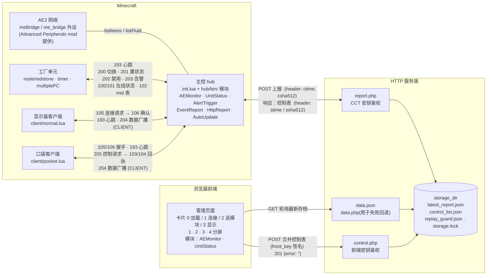

# CCT Factory Hub
English version: [README.md](README.md)

CCT Factory Hub 是一套「游戏内监控 + Web 远程管理」的工厂自动工具套件。

* **控制端 (hub)** 汇总各工厂单元的状态与 AE2 存储数据(需要 Advanced Peripherals mod)，显示在游戏内显示器上;
* **HTTP 上报模块** 定时把汇总数据签名上报到 PHP 服务端，并取回浏览器下发的控制指令;
* **Web 前端** 随时查看这些数据，持有操作密钥时可远程切换单元启停;
* **客户端** 让你在不离开游戏的情况下用显示器或口袋电脑查看现场状态。

| 能力         | 运行环境*     | 说明                                                            |
| ------------ | ------------- | --------------------------------------------------------------- |
| 单元状态监控 | hub、front    | 运行中 / 待机 / 已停止 / 已禁用 / 未知 五态，显示器分页展示     |
| AE2 存储监控 | hub、front    | 按配置只采集关心的物品与流体，带涨跌趋势箭头                    |
| 阈值告警     | hub           | 低于/高于阈值触发，可下发告警信号或直接切换单元                 |
| 远程控制     | front、client | 浏览器或口袋电脑点一下即可切换单元启停，双向回执                |
| 断线自恢复   | (all)         | 单元、客户端、控制端全部自动重连并重新握手                      |
| 平台无关     | server        | 服务端只有一个 `storage_dir` 需要关心，其余由 `publish.sh` 生成 |
| 零构建前端   | front         | 原生 ESM，浏览器直接加载，无需 Node 构建流程                    |

\* 具体信息请参考下文细节

---

## 1. 系统架构

### 1.1 总览表
| 角色              | 载体                       | 职责                                     |
| ----------------- | -------------------------- | ---------------------------------------- |
| **hub** 控制端    | 主 CC:T 计算机             | 加载模块、汇总数据、指挥单元、上报与下发 |
| **node** 工厂单元 | 每个单元自己的 CC:T 计算机 | 收发指令、控制红石输出、回传自身状态     |
| **client** 客户端 | 显示器终端 / 口袋电脑      | 只读查看，口袋电脑可点选切换             |
| **server** 服务端 | 任意 PHP 8 主机            | 存档最新上报、暂存控制表、校验签名       |
| **front** 前端    | 静态 HTTP 目录             | 展示数据、下发控制、多模块分屏           |

### 1.2 完整结构图


### 1.3 目录结构
```
CCT-Factory-Hub/
├── hub/                        控制端 (复制到 CC 计算机) 
│   ├── init.lua                主程序：模块加载 / 事件循环 / 调试掩码
│   ├── startup.lua.example     入口模板 (复制为 startup.lua 后修改) 
│   ├── bin/                    功能模块 (按文件名自动加载，字母序) 
│   │   ├── AEMonitor.lua       AE2 存储监控模块
│   │   ├── UnitStatus.lua      单元状态监控与控制模块
│   │   ├── AlertTrigger.lua    阈值告警模块
│   │   ├── EventReport.lua     客户端连接与会话管理模块
│   │   ├── HttpReport.lua      HTTP 外部通信模块
│   │   └── AutoUpdate.lua      配置自动更新模块  (从软盘读取新配置) 
│   ├── etc/                    模块配置 (同名 .json) 
│   │   └── *.json.example      
│   ├── log/                    运行日志
│   │   ├── hub.log             当前日志
│   │   └── hub.log.1 …         归档日志 (默认保留 2 份) 
│   └── lib/
│       ├── MiniNet.lua         无线网络协议封装
│       ├── log.lua             分级日志类
│       ├── loadJson.lua        JSON 读取
│       ├── formatAmount.lua    数值格式化
│       ├── TaskQueue.lua       异步任务/超时队列
│       └── sha2.lua            第三方 SHA-2 实现 (https://github.com/Egor-Skriptunoff/pure_lua_SHA)
├── node/                       工厂单元 (放到单元计算机上运行) 
│   ├── redstone.lua            红石输出型
│   ├── timer.lua               定时作业型
│   └── multiplePC.lua          托管子机群型
├── client/                     客户端 (放到显示器终端/口袋电脑上运行) 
│   ├── normal.lua              显示器版 (分页 + 触摸翻页) 
│   └── pocket.lua              口袋电脑版 (点击行内按钮切换) 
├── server/                     PHP 服务端
│   ├── bootstrap.php           签名校验 / 重放防护 / 原子写入 / 文件锁
│   ├── report.php              CCT 端上报接口
│   ├── control.php             前端控制接口
│   ├── data.php                前端读取兜底接口
│   ├── config.example.php      配置模板
│   └── publish.sh              一键部署脚本
└── front/                      Web 前端 (静态托管) 
    ├── index.html              单页骨架
    ├── index.js                连接 / 卡片切换 / 轮询 / 模块加载
    ├── index.css               布局 (含深色模式) 
    ├── config.js               集中配置 (轮询间隔、超时等) 
    ├── lib/                    sendControl / showNote / format
    └── module/                 功能模块
        ├── activated.json      模块注册表
        ├── common.css
        ├── AEMonitor/
        └── UnitStatus/
```

---

## 2. 快速开始

### 2.1 前置条件

* **Minecraft + CC:Tweaked**建议 CC:T 1.100 及以上;
* 每台参与通信的计算机都需要 **无线调制解调器**;
* hub 需要 **显示器** (高级显示器更好，可按模块配置);
* AE2 监控需要 **Advanced Peripherals** 提供的 `meBridge` (1.21.1 起外设名改为 `me_bridge`，两者都兼容) ;
* 服务端需要 **PHP 8** (无扩展依赖) 与一个能托管静态文件的 Web 服务器;
* 浏览器需要支持 ES Module 与 `crypto.subtle` (现代浏览器均可;**非 HTTPS 的局域网 IP 下 `crypto.subtle` 可能不可用**，需要 HTTPS 或 localhost)。

### 2.2 服务端

```bash
# 方法一: 只指定部署位置其他使用默认配置
bash server/publish.sh -d /path/to/webroot/cct-hub

# 方法一: 使用指定配置
bash server/publish.sh \
  -d /var/www/cct \
  -S /var/lib/cct-hub \
  -c "$(openssl rand -hex 32)" \
  -f "$(openssl rand -hex 32)"
```

| 参数 | 说明                         | 默认                                                                                                        |
| ---- | ---------------------------- | ----------------------------------------------------------------------------------------------------------- |
| `-d` | 部署目标目录 (必需)          | —                                                                                                           |
| `-S` | 数据存储目录                 | `/dev/shm/CCT-Factory-Hub`，不可写时退回 `<部署目标目录>/.storage`<br>(若手动指定需确保目录对php进程可读写) |
| `-c` | CCT 端密钥 (64 位十六进制)   | 随机生成                                                                                                    |
| `-f` | 前端操作密钥 (64 位十六进制) | 随机生成                                                                                                    |
| `-h` | 帮助                         | —                                                                                                           |

部署结果：目标目录内出现 `report.php`、`control.php`、`data.php`、`bootstrap.php`、`config.php` (权限位为600)，并尝试建立 `data.json → <存储目录>/latest_report.json` 的符号链接 (失败仅告警，前端会自动回退到 `data.php`)。

**两个须处理的值**:
1. CCT端密钥: 填入 hub 的 `HttpReport.json`;
2. 前端密钥:  用于前端控制的授权。

服务端接口一览：

| 接口          | 方法 | 认证     | 作用                           |
| ------------- | ---- | -------- | ------------------------------ |
| `report.php`  | POST | CCT 密钥 | 上报数据 + 取走控制表          |
| `control.php` | POST | 前端密钥 | 写入控制表 / 心跳探测          |
| `data.php`    | GET  | 无       | 只读获取最新数据 (CORS 已放开) |
| `data.json`   | GET  | 无       | 同上，静态文件直读 (更快)      |

### 2.3 控制端 hub

方法一: 手动把 `hub/` 内的内容复制进 CC:T 计算机本地存储文件夹并复制模板后修改;

方法二: 在要部署的计算机运行 `wget run https://server2.ycl.cool/CC:T/CCT-Factory-System/install_hub.lua` 来进行自动部署，完成后复制模板并修改。

须注意：
1. **外设**：无线调制解调器 (必需) 、显示器 (按模块配置的 `monitor.name`) 、`meBridge` (AEMonitor 必需) 。
2. **信道**: 模板默认使用计算机 ID 作为无线信道。要让单元与客户端连上，建议显式指定 `init:new({ netChannel = 4096 }):doMainLoop()`;
3. **目录结构**: `require("init")` 依赖 `package.path`，且程序按入口脚本所在目录推导 `/bin`、`/etc`、`/lib`和`/log`。

`Hub:new()` 可选项：

| 选项            | 类型    | 默认           | 说明                                                               |
| --------------- | ------- | -------------- | ------------------------------------------------------------------ |
| `netChannel`    | number  | 计算机 ID      | 无线信道号 (0-65535) ，所有单元/客户端一致                         |
| `netName`       | string  | 第一个无线网卡 | 指定使用哪块调制解调器                                             |
| `timerInterval` | number  | `5`            | 轮询间隔秒数;(`<2` 拒绝启动，`<4` 或 `>600` 告警)                    |
| `debugMode`     | number  | `0`            | 调试掩码 (见 §5.3) ，需置位 0x0001/0x0002 才生效                   |
| `noLog`         | boolean | `false`        | 静音日志 (同时不创建日志文件)                                      |
| `noTimer`       | boolean | `false`        | 关闭轮询 (无模块注册 poll 时自动开启)                              |
| `noTerminate`   | boolean | `false`        | 忽略 `terminate` 事件                                              |
| `noReboot`      | boolean | `false`        | 阻止计算机重启                                                     |
| `disabledUnits` | table   | `{}`           | 要跳过的模块名列表，如 `{ "AutoUpdate" }`                          |
| `logFileSize`   | number  | `102400`       | 单个日志文件最大字节数;`-1` 不限制，`0` 或非法值回退默认           |
| `logFileCount`  | number  | `3`            | 日志文件总数 (含 `hub.log`) ;`0` 禁用文件输出，`-1` 归档数量不限制 |

仓库中的 `hub/startup.lua.example` 的 `disabledUnits` 里的条目默认是注释状态，取消注释即可禁用对应模块;正式运行时把 `dbgMode` 改为 `0`
 (或改用 `noLog = true` 静音日志) 。

若日志开启控制端默认会把日志同时写进程序目录下的 `log/hub.log` (目录不存在时自动创建)，每次启动先追加一行 `------ [yyyy-mm-dd hh:mm:ss] ------` 分隔行，单个文件超过 `logFileSize` 时自动滚动为 `hub.log.1`、`hub.log.2`……;

`logFileCount` 是**含 `hub.log`在内**的文件总数，默认 `3` 即 `hub.log` + 2 份归档，设 `0` 关闭文件输出 (屏幕日志仍然保留) ，设 `-1` 则归档数量不设上限。`noLog = true` 会静音全部日志，此时不会创建日志文件 (调试模式下日志仍会开启并写入)。


**模块配置**：复制模板并填写，文件名必须与 `bin/` 中的模块同名：

| 文件                 | 关键字段                                                                                            |
| -------------------- | --------------------------------------------------------------------------------------------------- |
| `AEMonitor.json`     | `monitor{name,minWidth,minHeight}`、`list[]` (`id`/`name`/`type=item\|fluid`/`unit`) 、`queueEvent` |
| `UnitStatus.json`    | `monitor{...}`、`list[]` (`name`/`tag`，`tag` 必须与单元 `user.lua` 一致)                           |
| `AlertTrigger.json`* | **顶层数组**，每项 `objectId`/`objectType`/`cellType`/`cellTag`/`thresholds[]`                      |
| `HttpReport.json`    | `key` (CCT 密钥) 、`url` (`report.php` 地址) 、`relaySide`、`relayName` (可选) 、`timeTolerance`    |

\* `AlertTrigger` 的 `cellType` 决定下发哪种信号：`0` 告警 (203) 、`1` 置状态 (201) 、`2` 置禁用 (202) ;`thresholds[].type` 为 `less` / `more`，`alertType` 为 `0` 每次跨越都发、`1` 仅告警一次并在恢复时静默重新武装、`2` 告警与恢复都发。

### 2.4 工厂单元 node

方法一: 把需要的对应脚本与 **自写的 `user.lua`** 一起放到单元计算机上，并把该脚本设为启动项;

方法二: 在要部署的计算机使用 `wget` 从 `https://server2.ycl.cool/CC:T/CCT-Factory-System/node/` 路径前缀下载 (网站目录内文件结构和仓库 `node/` 文件夹相同)，完成后将 **自写的 `user.lua`** 放到单元计算机上。

> 单元脚本通过 `require("user")` 加载配置。若启动时提示 `User script load error: module 'user' not found`，请确认两个文件在同一个目录。

`user.lua` 按机型导出不同内容 (三端都必须有 `staticCfg`) :
```lua
local M = {}

M.staticCfg = {
    tag        = "carpet_production", -- 与 hub/etc/UnitStatus.json 中的 tag 一致
    serverId   = 4096,                -- hub 的无线信道 (不是计算机 ID) 
    input      = 2,                   -- 可选：硬禁用输入侧 (1 bottom … 6 left) 
    output     = 3,                   -- redstone 型: 红石输出侧
    waitTime   = 10,                  -- timer 型: 每次运行的时间间隔(单位: 分钟)
    childInId  = 1,                   -- multiplePC 型: 与有线网络中子计算机通信的上行信道ID
    childOutId = 2                    -- multiplePC 型: 与有线网络中子计算机通信的下行信道ID
}

-- redstone / timer 型必需，multiplePC 型不需要
function M.doControl(runData, side, hardDisabled)
    -- runData.status: 是否运行中; runData.disabled: 是否软禁用
    redstone.setOutput(side, runData.status)
end

-- 可选: 重启后恢复现场
function M.doRecovery(runData, side) end
-- 可选:收到 203 告警时回调
function M.doTrigger(runData, tag, status) end
-- 可选: 额外事件钩子，如 M.eventMap = { modem_message = fn }
M.eventMap = {}

return M
```

| 机型             | `staticCfg`                                                | 必需函数                                 | 典型用途         |
| ---------------- | ---------------------------------------------------------- | ---------------------------------------- | ---------------- |
| `redstone.lua`   | `tag`、`serverId`、`output`、可选 `input`                  | `doControl(runData, side, hardDisabled)` | 单台红石机器启停 |
| `timer.lua`      | `tag`、`serverId`、`waitTime`、可选 `input`                | `doControl(runData, hardDisabled)`       | 周期性作业       |
| `multiplePC.lua` | `tag`、`serverId`、`childInId`、`childOutId`、可选 `input` | **无** (控制交给子机)                    | 托管多台子机群   |

`runData` 三个字段: `status` (运行中) 、`disabled` (软禁用) 、`serverOnline` (与 hub 的会话是否在线) 。

### 2.5 客户端 client

方法一: 把需要的对应脚本复制单元计算机存储目录中;
方法二: 在要部署的计算机使用 `wget` 从 `https://server2.ycl.cool/CC:T/CCT-Factory-System/client/` 路径前缀下载 (网站目录内文件结构和仓库 `client/` 文件夹相同)。

在终端/口袋电脑上设置好信道即可运行：
```sh
set factoryhub.serverId 4096            # 与 hub 的 netChannel 一致
set factoryhub.monitorName monitor_1    # normal.lua 需要，指定输出显示器

normal.lua/pocket.lua                   # 运行对应文件
```

* `client/normal.lua`：在显示器上分页展示单元状态，触摸底部 `Last / Next` 翻页，断线自动重连;
* `client/pocket.lua`：在口袋电脑上展示，点击行内按钮直接发起切换，按钮锁定至收到回执或超时。

### 2.6 Web 前端

> ⚠️ **外部依赖**：`front/index.js` 从 `https://tool.ycl.cool/public-library/function.esm.min.js` 引入 `getUrlParams` / `isMobile` / `loadExternalResource` 三个工具函数。离线或内网部署时，请把该库下载到本地并改写 `index.js` 顶部的 import 路径，否则面板无法启动，此模块的源代码可在 [https://github.com/YCL0609/YCL-Public-library](https://github.com/YCL0609/YCL-Public-library) 找到。

打开页面后填写：

| 字段       | 说明                                                                     |
| ---------- | ------------------------------------------------------------------------ |
| 服务器地址 | `report.php` / `control.php` 所在目录的完整 URL，不带结尾 `/`            |
| 操作密钥   | `config.php` 里的 `front_key`;**留空则以只读模式运行**，只能观看不能下发 |

URL 参数 (可组合) ：

| 参数     | 说明                                     | 示例                                     |
| -------- | ---------------------------------------- | ---------------------------------------- |
| `server` | 预填服务器地址 (需 `encodeURIComponent`) | `server=http%3A%2F%2F192.168.1.10%2Fcct` |
| `select` | 预选模块，逗号分隔                       | `select=AEMonitor,UnitStatus`            |
| `mode`   | 分屏模式 1-4                             | `mode=2`                                 |
| `auto`   | 为真时自动连接并进入显示页               | `auto=1`                                 |

显示模式：`1` 单模块、`2` 左右两栏、`3` 左一右二、`4` 四宫格;可选的模块数量必须与模式匹配。轮询间隔默认 15s，页面切到后台时自动暂停。

AEMonitor 前端模块需要一份 `module/AEMonitor/list.json`:
```json
{
  "items":   ["minecraft:coal", "minecraft:quartz"],
  "fluids":  ["mekanism:hydrogen"],
  "reverses": ["minecraft:coal"]
}
```
`reverses` 字段用于把某项的趋势箭头反向。

---

## 3. 通信协议 (CC 内网) 

所有 CC 设备共用**同一个无线信道** (hub 的 `netChannel`，单元与客户端里为 `serverId`) ，靠消息体里的 `tag` 做逻辑寻址;

接收端校验 `modem_message` 事件的第 4 项 replyChannel 等于 `serverId` 后第 5 项就是消息体:
```lua
{
    tag  = "carpet_production", -- 目标：单元 tag;"ALL" 全体;"CLIENT" 客户端
    code = 200,                 -- 消息码 (见下表) 
    mid  = "a1b2c3",            -- 消息 ID：请求与 103/104 回执配对
    data = { },                 -- 附带数据，可选
}
```

**消息码**：

| 码    | 方向              | 含义                                                                  |
| ----- | ----------------- | --------------------------------------------------------------------- |
| `100` | hub → 全体        | 主机上线 (单元/客户端据此重新握手)                                    |
| `101` | hub → 全体        | 主机离线                                                              |
| `102` | hub → 全体        | 同步 mid 表 (`data = { tag = mid }`)                                  |
| `103` | 任意 → 请求方     | ACK (配对 `mid`，可带 `data`)                                         |
| `104` | 任意 → 请求方     | NCK 拒绝 (配对 `mid`)                                                 |
| `105` | 客户端 → hub      | 客户端连接请求 (`data.clientId`)                                      |
| `106` | hub → 客户端      | 连接确认 (`tag = "CLIENT"`，`data.clientId`)                          |
| `107` | 客户端 → hub      | 客户端断开                                                            |
| `193` | 单元/客户端 → hub | 心跳 (`data.status` 可选携带状态)                                     |
| `194` | hub → 单元/客户端 | 心跳应答失败 (NCK Ping)                                               |
| `200` | hub → 单元        | 切换单元状态 (`tag` 必填，`"ALL"` 合法)                               |
| `201` | hub → 单元        | 指定单元状态 (`data.status` 布尔，禁止 `ALL`，仅停止/运行型单元)      |
| `202` | hub → 单元        | 切换禁用状态 (`ALL` 合法，可被物理信号覆盖)                           |
| `203` | hub → 单元        | 触发告警 (`data.tag`、`data.status`)                                  |
| `204` | hub → 客户端      | 运行数据推送 (`tag = "CLIENT"`，`data.type` 事件名、`data.data` 内容) |
| `205` | 客户端 → hub      | 请求切换单元 (`tag` 必填、禁止 `ALL`、`payload.mid` 为客户端标识)     |

`MiniNet` 库 (`hub/lib/MiniNet.lua`) 封装了上述细节：

| 方法                                                         | 说明                                                                                                                              |
| ------------------------------------------------------------ | --------------------------------------------------------------------------------------------------------------------------------- |
| `net:send(tag, code, data, retryLimit, callback)`            | 发送并等待 `103/104`，返回 `mid`;`retryLimit` 是**允许的超时次数** (传 `2` 表示超时 1 次后放弃) ，`callback` 收到回执或超时后触发 |
| `net:broadcast(tag, code, data, mid)`                        | 直接广播                                                                                                                          |
| `net:startTasks({mid, rawCount, callback})` / `stopTask(id)` | 注册常驻任务 (如客户端会话)                                                                                                       |
| `net:setMessageListener(code, fn)`                           | 接管某个消息码 (`<200` 视为统一回调 0;一个码只能有一个监听者)                                                                     |
| `net:poll()` / `net:epoll(event)`                            | 由主循环驱动                                                                                                                      |
| `net:open(ids)` / `net:close()`                              | 打开/关闭信道                                                                                                                     |

回调函数签名：`(taskId, code, isTimeout, returnedData) -> boolean`，返回 `true` 表示继续监听。

---

## 4. HTTP 协议

### 4.1 签名

所有写操作都必须签名 (CCT 端用 `cct_key`，前端用 `front_key`，两者都是 64 位十六进制字符串) ：

```
body    = 请求体的原始 JSON 字符串 (逐字符一致，不能重新序列化) 
ctime   = 毫秒时间戳字符串
csha512 = HMAC-SHA512(key, body .. ctime)   -- 小写十六进制
```

请求头：`ctime: <ctime>`、`csha512: <csha512>`、`Content-Type: application/json`。

服务端在 `time_tolerance_ms` (默认 30000ms) 偏移内校验通过才处理，并把 `(ctime, csha512)` 登记到 `replay_guard.json`：**同一组签名只能使用一次** (重复 → `409`) ，登记失败则拒绝 (fail-closed) 。

响应也带签名头：`stime`、`ssha512 = HMAC-SHA512(cct_key, body .. stime)`，CCT 端据此校验响应未被篡改。

### 4.2 上报 `POST report.php` (CCT 密钥) 

请求体是自由组织的 JSON，被原样包进存档：

```json
{
  "unit_status_change": [
    { "tag": "carpet_production", "name": "Carpet production", "status": 4, "inProcess": false }
  ],
  "ae2_cache_update": {
      "items":  {
        "minecraft:coal": { "name": "minecraft:coal", "amount": 12345 } 
    },
    "fluids": {
        "mekanism:hydrogen": { "name": "mekanism:hydrogen", "amount": 4500 }
    }
  }
}
```

服务端存档结构 (`latest_report.json` / `data.json`) ：
```json
{ "report_time": "1750000000000", "data": { } }
```

\* `data` 字段存储的是上报体

响应体是**控制表** (读走即清空) ：

```json
{ "carpet_production": true }
```

| 状态码 | 含义                                   |
| ------ | -------------------------------------- |
| `200`  | 成功，响应体为控制表 (无指令时为 `{}`) |
| `400`  | 缺少签名头 / JSON 非法                 |
| `401`  | 签名错误                               |
| `403`  | 时间戳超出容差                         |
| `409`  | 重放 (同 ctime + 同签名已用过)         |
| `500`  | 存储不可写                             |

### 4.3 控制 `POST control.php` (前端密钥) 

请求体是**对象** (数组会被拒绝) ：

```json
{ "carpet_production": true }
```

合并语义 (服务端对已有控制表做读-改-写，全程持有文件锁) ：

| 写法                                   | 效果                |
| -------------------------------------- | ------------------- |
| `{ "tag": true }` / `{ "tag": false }` | 置为指定值          |
| `{ "tag": null }`                      | 删除该条目          |
| `{ "__reset": true }`                  | 清空整张控制表      |
| 其他 `__` 开头的键                     | 忽略 (预留给服务端) |

| 状态码                | 含义                                      |
| --------------------- | ----------------------------------------- |
| `201`                 | 写入成功 (`{"error":""}`)                 |
| `204`                 | 心跳探测 (`{"ping":true}`) ，不写任何东西 |
| `400`                 | 请求体不是对象                            |
| `401` / `403` / `409` | 同上报接口                                |
| `500`                 | 存储不可写                                |

### 4.4 读取 `GET data.php` / `data.json`

返回存档结构 (`report_time` + `data`) ，带 CORS 头。尚未上报时返回 `404 {"error":"No report data available yet"}`。前端先试静态 `data.json` (快) ，失败再退回 `data.php`。

---

## 5. 扩展开发

### 5.1 hub 模块

在 `hub/bin/` 新建 `MyModule.lua`，开机自动加载 (按文件名排序) ，配置从 `hub/etc/MyModule.json` 读取 (不存在则为空表) 。最小骨架：

```lua
local MyModule = {}
MyModule.__index = MyModule

--- @param config table      etc/MyModule.json 的内容
--- @param libs table        { log = Log, net = MiniNet, root = <hub 根目录> }
--- @param debugMode number  调试掩码
function MyModule:new(config, libs, debugMode)
    local obj = setmetatable({}, self)
    obj._config, obj._libs = config, libs
    return obj
end

--- 声明需要的事件：poll 定时、monitor 显示器、monitorName，other 自定义事件
function MyModule:getEventList()
    return { poll = true, monitor = false, other = { "my_custom_event" } }
end

--- 每 timerInterval 秒调用一次
function MyModule:poll() end

--- 接收原始 CC 事件 (含自定义事件、modem_message、monitor_touch…) 
function MyModule:epoll(event) end

return MyModule
```

要求：

* 自定义事件必须**在 `getEventList().other` 里登记**，否则 `os.queueEvent("my_custom_event", ...)` 会被主循环丢弃;
* 保留事件 (`terminate`/`reboot`/`poll`/`newTask`/`modem_message`/`monitor_touch`) 不可注册;
* 用 `libs.log` 打日志 (`debug/info/warn/error/fatal/fatalNoExit`) ;
* 模块抛出的异常会被 `pcall` 隔离，不会拖垮整机;`new` 失败只跳过该模块。

向前端推送数据的两种方式：
1. **复用 `EventReport`**：当前它只转发 `ae2_cache_update` 与 `unit_status_change` 两个事件 (受 `EventReport.json` 的 `noAE2Update` / `noUnitChange` 控制) 。要增加事件类型，需在该模块的 `_enabledMap` 里追加键名 —— 属于修改核心模块，谨慎为之。
2. **自己推送**：直接 `libs.net:broadcast("CLIENT", 204, { type = "my_data", data = payload })`，前端模块在 `dataUpdate` 里按 `data.my_data` 取用。事件需要先投递给你的模块 (`os.queueEvent("my_data", payload)` + 在 `getEventList().other` 里登记) ，缓存与重连补发由你自己负责。

### 5.2 前端模块

在 `front/module/` 新建目录，实现三个方法，并在 `front/module/activated.json` 注册：

```js
// front/module/MyModule/index.js
export default class MyModule {
    async init(ctx) {}                    // 加载配置、建 DOM (可 fetch 自己的静态 JSON) 
    dataUpdate(data, ctx) {}              // data 是上报体的 data 字段
    divUpdate(node, isFirst, ctx) {}      // node 是一个 pane 容器，isFirst 表示首帧
}
```

```jsonc
// front/module/activated.json
[{ "name": "MyModule", "desc": "一句话说明", "css": true }]
```

`ctx` 提供：

| 字段                                    | 说明                                         |
| --------------------------------------- | -------------------------------------------- |
| `ctx.sendData(payload)`                 | 下发控制 (只读模式下自动忽略并提示)          |
| `ctx.showNote(level, text, noTimeout?)` | 右上角提示，`level` 为 `info`/`warn`/`error` |
| `ctx.config`                            | `config.js` 中 `modules.<模块名>` 的对象     |
| `ctx.getReportTime()`                   | 最近一次上报时间                             |

约定：`dataUpdate` 只处理数据，`divUpdate` 只负责渲染，两者都会被 `render_timeout` (5s) 兜底;`css: true` 时宿主会自动加载同目录 `index.css`。

### 5.3 调试掩码

`Hub:new({ debugMode = ... })` 传入整数，按位组合 (置位 0x0001 或 0x0002 才算开启) ：

| 位  | 值       | 作用                                              |
| --- | -------- | ------------------------------------------------- |
| 0   | `0x0001` | 开启调试模式 (日志级别 DEBUG)                     |
| 1   | `0x0002` | 额外启动调试 shell，并把 hub 对象挂到 `_G.HubObj` |
| 2   | `0x0004` | 强制禁用所有事件处理                              |
| 3   | `0x0008` | 禁用屏幕点击                                      |
| 4   | `0x0010` | 禁用网络事件 (`modem_message`)                    |
| 5   | `0x0020` | 禁用自定义事件                                    |
| 6   | `0x0040` | 禁用重启逻辑                                      |
| 7   | `0x0080` | 保留给模块自定义                                  |
| 8   | `0x0100` | 把事件队列挂到全局                                |
| 9   | `0x0200` | 正常终止时挂起而非退出                            |
| 10  | `0x0400` | 退出时不清屏                                      |
| 11  | `0x0800` | 退出时不关闭网络                                  |

---

## 6. 安全说明

* **认证在服务端**：`control.php` 用 `front_key` 校验签名，校验失败一律 401/403，与前端是否"显示"按钮无关;
* **只读模式**：前端不填密钥时 `serverCtrl.readonly` 为真，点击控制按钮只会提示「未输入操作密钥, 已忽略控制信号」，服务端也拿不到合法签名;
* **密钥去向**：密钥只停留在你的浏览器内存 (`input` 元素) 与本机 JS 变量里，**不会进入 URL、请求体、localStorage 或日志**;签名用 `crypto.subtle` 在本地计算;
* **重放防护**：`(ctime, 签名)` 在时间窗内只能使用一次，重复请求返回 409;
* **观看侧是公开的**：`data.php` / `data.json` 无认证，任何能访问该 URL 的人都能看到工厂数据。请把它放在内网，或在前置代理上加访问控制;
* **共享密钥无审计**：`front_key` 是单一共享密钥，所有持钥者行为不可区分，也没有按用户的操作日志 (如需审计请在最外层反向代理记录) ;
* **CC 内网是明文**：无线信道上的消息没有加密，任何同信道的计算机都能读取，请勿在信道里传输敏感信息。

---

## 7. 排错

| 现象                                       | 排查方向                                                                           |
| ------------------------------------------ | ---------------------------------------------------------------------------------- |
| 计算机报 `modem peripheral not found`      | 没有无线调制解调器 / 未插入，或 `netName` 指向了有线网卡                           |
| hub 日志 `Module 'X' failed to load`       | `hub/bin/X.lua` 里 `require` 路径错，或缺少 `hub/lib/` 下的依赖                    |
| hub 日志 `Module 'X' failed to initialize` | `hub/etc/X.json` 字段不全或类型错误，按报错行号核对                                |
| 显示器一片空白                             | 模块未配置显示器名，或分辨率低于配置的 `minWidth`/`minHeight`                      |
| AEMonitor 报 `meBridge terminal not found` | 未安装 Advanced Peripherals，或桥接器不在同一网络                                  |
| 单元状态一直 `Unknown`                     | 单元 `tag` 与 `UnitStatus.json` 不一致，或单元未接入同一信道                       |
| 单元报 `User script load error`            | `user.lua` 不在 `require` 的搜索路径，见 §2.4 的提示                               |
| 前端"服务器报告当前无数据"                 | hub 还没成功上报过一次;先看 hub 的 HttpReport 日志                                 |
| 接口返回 401                               | 签名不匹配：浏览器 → `front_key` 是否与 `config.php` 一致;hub → `cct_key` 是否一致 |
| 接口返回 403                               | 时间戳超出容差 (`time_tolerance_ms`) ，校准两端时钟                                |
| 接口返回 409                               | 同一 `(ctime, 签名)` 被重复使用：检查 CCT 端是否重发了相同请求                     |
| hub 报 `Network error counter triggered`   | 连续 10 次以上请求失败，检查 URL / 服务器可达性 / 密钥                             |
| 前端面板打开即报错                         | 外部 CDN 不可达 (见 §2.6) ，把工具库改为本地引用                                   |
| 控制没反应                                 | 前端处于只读模式、`ignoreWebControl` 为真、或单元状态不在可切换区间 (2-6)          |

日志级别：`DEBUG → INFO → WARN → ERROR → FATAL → NONE`，默认 `INFO`;`noLog = true` 或 `debugMode = 0` 可静音。